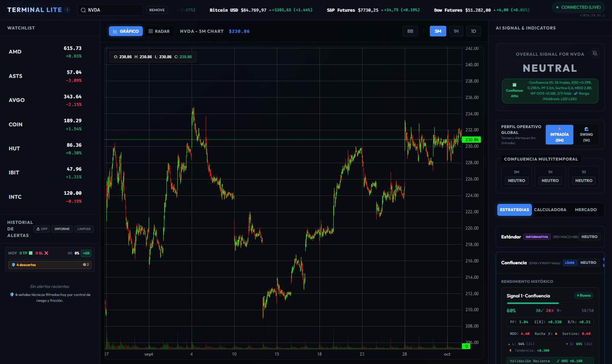
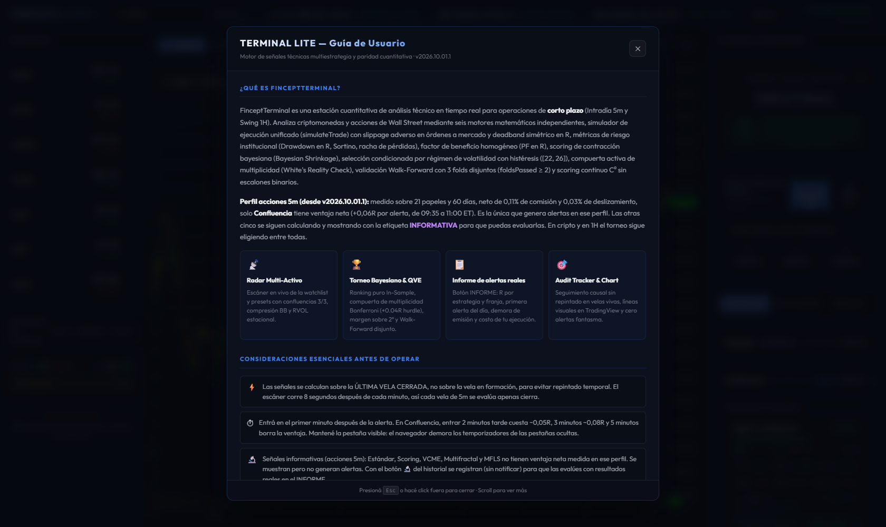

# FinceptTerminal 📈

**FinceptTerminal** es una aplicación web de análisis técnico diseñada para proporcionar señales de trading a corto plazo (intradía, operaciones que duran un día o como máximo una semana). Su objetivo principal es analizar activos altamente volátiles para capturar subidas (o bajadas) mediante algoritmos y estrategias basadas en indicadores matemáticos.

[**Ver Demo en Producción**](https://terminal-web-orpin.vercel.app) · Versión actual: **v2026.10.01.1**



---

## 🆕 Novedades v2026.10.01.1 — Perfil acciones 5m

Cambios basados en la medición de las seis estrategias sobre una watchlist de 21 acciones de EE. UU., 60 días de velas de 5m, neto de 0,11% de comisión y 0,03% de deslizamiento:

| Estrategia | E[R] neto por alerta | Estado en acciones 5m |
|---|---|---|
| **Confluencia** (09:35–11:00 ET) | **+0,061R** (0,85 alertas/papel/día, positiva en ambas mitades) | Única estrategia que genera alertas |
| Estándar | −0,13R | INFORMATIVA |
| Scoring | −0,23R | INFORMATIVA |
| VCME Sniper | −0,26R | INFORMATIVA |
| Multifractal MTF | −0,29R | INFORMATIVA |
| MFLS | −0,31R | INFORMATIVA |

* **Confluencia solo en la ventana de la mañana:** se eliminó la ventana de tarde con ADX ≥ 25 (−0,23R). Sin veto por historial del papel: solo se bloquea un papel con historia claramente tóxica en esa dirección (≥ 8 operaciones).
* **Estrategias informativas:** se siguen calculando, backtesteando y mostrando con la etiqueta INFORMATIVA, pero no ganan el torneo ni emiten alertas principales. Con el botón **🔬** del historial se registran (sin notificar) para evaluarlas con resultados reales. En cripto, 1H y 1D no cambia nada.
* **Radar coherente con las alertas:** usa la misma cola de estrategias que el escáner, muestra Confluencia como líder en acciones 5m (o "Confluencia vetada" si el papel tiene historia tóxica), se refresca al mismo ritmo que el escáner y la matriz "Alineación Estándar (5m · 1h · 1d)", antes llamada Confluencia MTF, queda marcada como informativa en acciones 5m.
* **Alertas sincronizadas con el cierre de la vela:** el escáner corre 8 s después de cada minuto y la caché de velas vence al cerrar cada vela de 5m. En Confluencia, entrar 2 minutos tarde cuesta ~0,05R, 3 minutos ~0,08R y 5 minutos borra la ventaja.
* **Informe de alertas reales (botón INFORME):** R por estrategia, franja horaria y primera alerta del día, demora entre el cierre de la vela y la alerta, y costo de ejecución contra el precio que cargás en cada alerta ("Mi entrada"). Las alertas cerradas se archivan 90 días.
* Corrección: las velas de 1H de IBIT (Yahoo rechazaba `range=730d`) se piden con `range=2y` como respaldo.

Los resultados son históricos y no garantizan rentabilidad futura. La validación fuera de muestra es el propio informe de alertas reales.



Historial técnico detallado de versiones anteriores: [`AI_CONTEXT.md`](AI_CONTEXT.md).

---

## 🚀 Características Principales

* **Gráficos Ultra Rápidos (Lightweight Charts):** Representación visual de velas japonesas y volumen con un rendimiento excepcional usando TradingView's lightweight-charts. Sincronización horaria local en el eje temporal (`formatLocalTickMark`) para alinear la leyenda del cursor con los tick marks del eje X en la zona horaria del usuario.
* **Leyenda Flotante Dinámica (OHLC & BB):** Panel interactivo que se mueve con el cursor (`crosshair`) para mostrar datos del precio exacto e información de expansión de las Bandas de Bollinger sin causar costosos re-renderizados en React (manipulación directa del DOM).
* **Watchlist Paralelizada:** Carga múltiple de tickers de manera concurrente para asegurar tiempos de espera mínimos.
* **Multi-Soporte de Mercados:**
  * **Criptomonedas:** Obtención de datos mediante WebSockets en tiempo real (Binance) y agregadores de datos históricos.
  * **Mercados Tradicionales/Stocks:** Integración con Data Feeds de baja latencia para stocks, ETFs y futuros.
* **Indicadores de Señal Activa en Watchlist:** Badges de neón 🟢 **`BUY`** o 🔴 **`SELL`** que aparecen dinámicamente al lado de los símbolos mientras su alerta permanezca en estado `OPEN` o `TP1_HIT`, desapareciendo automáticamente al cerrarse o expirar el trade.
* **Notificaciones de Escritorio Enriquecidas con Niveles de Trading:** Notificaciones del sistema operativo que detallan directamente los puntos exactos de `Entry`, `SL`, `TP1` y `TP2` para que el trader pueda operar sin abrir la app.
* **Telemetría y Observabilidad de Señales Descartadas en Vivo:** Contador persistente en la barra de sesión que categoriza las señales silenciadas en 5 motivos (`friction`, `marketHours`, `cooldown`, `activeTrade`, `geometry`), con deduplicación atómica por vela, visualización inmediata de cantidades en el panel y tooltip descriptivo sin desbordamiento ni recortes.
* **Motor QVE de Ventaja Estadística & Torneo Bayesiano:** Torneo cuantitativo centralizado (`tournament.ts`) que evalúa el rendimiento histórico de las 6 estrategias mediante contracción bayesiana monótona hacia el prior nulo ($E[R]_{\text{shrunk}} = E[R] \cdot \frac{N}{N+N_0}$), normalización temporal sub-difusiva, modulación dinámica por régimen de mercado con histéresis ($\text{ADX} \ge 26$ vs $\le 22$), compuerta activa de multiplicidad (White's Reality Check / Bonferroni) con hurdle de expectativa deflactada en $R$ ($E[R]_{\text{deflated}} \ge +0.040R$) uniforme e independiente de la duración, margen de separación escalonado sobre el 2º candidato, penalización de drawdown ($MDD_R > 2.5R$), consistencia Sortino y certificación ciega Walk-Forward con 3 folds disjuntos (`foldsPassed ≥ 2` para `HIGH`).
* **Factor de Beneficio Homogéneo en Unidades de Riesgo ($\text{PF}_R$):** Cálculo unificado de $\text{PF}_R = \frac{\sum R_i > 0}{\sum |R_j < 0|}$ en todos los motores y desgloses direccionales, garantizando perfecta comparabilidad matemática e invarianza de escala entre scalps estrechos de 5m y swings amplios de 1H.
* **Selección Dinámica Condicionada por Régimen de Mercado (`regimeStats`):** Filtro de compuerta dura que descalifica estrategias con expectativa negativa demostrada en el régimen activo ($E[R]_{\text{regime}} < 0$), e impulsa suavemente los motores con ventaja estadística específica (momentum/ruptura en tendencia $\text{ADX} \ge 26$, reversión a la media en rango $\text{ADX} \le 22$) con banda de histéresis $[22, 26]$ anti-chattering.
* **Simulador de Ejecución Unificado (`simulateTrade`):** API compartida por los seis backtests y el tracker, implementada en `executionEngine.ts`. Conserva un checkpoint versionado con fills, cantidad remanente y última observación; aplica stops sobre el estado vigente, admite TP3 explícito y respeta `trailingStop: 'none'`. La igualdad histórico/reanudación se verifica con entradas equivalentes; OHLC por sí solo no determina el orden intravela.
* **Métricas de Riesgo Institucionales & Tiempo de Ciclo:** Evaluación de Max Drawdown en R ($MDD_R$), Racha Máxima de Pérdidas ($L_{\text{streak}}$ evaluado en retornos netos), Ratio Sortino sobre la serie de retornos en R, Exposición Efectiva ($t_{\text{ciclo}} = t_{\text{trade}} + t_{\text{cooldown}}$), desglose direccional ($\Delta$ Long / Short) y desglose por régimen tendencial ($ADX \ge 26$ vs $ADX \le 22$).
* **Validación Walk-Forward Multi-Fold Disjunta:** Partición del tramo Out-of-Sample en 3 sub-ventanas temporales disjuntas y ciegas ($[0, \frac{1}{3})$, $[\frac{1}{3}, \frac{2}{3})$, $[\frac{2}{3}, 1.00]$) con purga estricta de straddlers entre fronteras y compuerta activa `foldsPassed ≥ 2` como requisito de estabilidad temporal para otorgar confianza `HIGH`.
* **Scoring Multicapa Continuo ($C^0$) & Geometría de Riesgo Escalada:** Mapeos continuos suaves mediante tangentes hiperbólicas ($\tanh$) en Capa 1 (EMA mayor), Capa 4 (VWAP con rampa continua en 1.8-2.2 ATR) y Capa 4 (OBV en diario) que erradican saltos discretos y knife-edges de ruido. Umbral calibrado al 40% del potencial alcanzable (2.50 en 5m, 2.80 en 1h/1d). Escalado dinámico del horizonte temporal proporcional al riesgo (Confluencia a 10 velas en 5m / 7 velas en 1h con SL 2.0 ATR y TP 3.0 ATR) para evitar expiraciones artificiales por timeout.
* **Caché Multi-Timeframe con Fingerprint FNV-1a Bit-Exacto & Recálculo en Vivo:** Huella compuesta de 32-bits (FNV-1a) que procesa la totalidad de la serie de velas ($0..N-1$) serializando los bytes IEEE 754 de timestamp, open, high, low, close y volume mediante buffers binarios (`Float64Array` + `Int32Array`) sin submuestreos aleatorios ni fijos, detectando cambios históricos mediante una huella compacta. El coste del hash depende de la cantidad de velas y del equipo; no se garantiza una latencia fija ni ausencia de colisiones en 32 bits.
* **Reconciliador Incremental Puro de Gráficos (`isChartDataIncremental`):** Helper algorítmico puro en `src/utils/chartHelpers.ts` que determina si las nuevas velas extienden incrementalmente el gráfico de TradingView o requieren reemplazo completo, aislando la lógica de reconciliación de los componentes de React y habilitando cobertura de pruebas unitarias directas.
* **Múltiplos R Ponderados Dinámicos:** Cálculo matemático exacto de $R$ en base a distancias reales de niveles (+0.71R netos en TP1_BE, +1.71R / +1.875R en TP2, runner flotante) reflejado de manera sincronizada en el panel de auditoría y en los labels de TradingView.
* **Arquitectura Single Source of Truth (SSOT):** Centralización de los 6 evaluadores puros en `src/utils/strategyEvaluators.ts`, garantizando equivalencia matemática 1:1 estricta entre Live y Backtest, y encapsulando los filtros de tendencia macro y volumen sin filtrado ad-hoc en componentes de React.
* **Motor de Calendario Bursátil NYSE/NASDAQ & DST:** Detección de horario de verano en EE.UU. (EST/EDT), horario de sesión regular (09:30-16:00 ET), festivos de Wall Street y cierres tempranos para cálculo exacto de velas cerradas en acciones sin desfases.
* **Cooldowns Canónicos & Simetría Temporal Post-Salida:** Estandarización de tiempos de ciclo y enfriamiento a partir de la salida efectiva del trade (`exitIdx + cooldownPeriod`) a través de helpers canónicos (`getStrategyCooldownCandles` / `getStrategyCooldownMs`) en 1 hora (12 velas 5m), 4 horas (4 velas 1H) y 48 horas (2 velas 1D), eliminando ventajas artificiales en la métrica $R/\text{hora}$ del torneo.
* **Torneo QVE con Estado FLAT (`NONE`) & Filtro Direccional Unificado:** Detección de regímenes de mercado sin ventaja estadística ($E[R] \le 0$) declarando `Sin Estrategia (Flat)`, y filtro direccional compartido (`sanitizeSignalWithDirectionalEdge`) con umbral robusto de $N \ge 3$ trades para silenciar señales contra la expectativa histórica.
* **Sanitizador y Geometrización Estricta de Velas (`sanitizeKlines`):** Validación exhaustiva de integridad matemática y temporal en feeds de Yahoo Finance y Binance, garantizando $high \ge \max(open, close)$, $low \le \min(open, close)$, finitud de valores, deduplicación de timestamps y ordenamiento ascendente.
* **Radar de Mercado Adaptativo & Filtrado Desacoplado:** Misma cola de estrategias y cascada que el escáner de alertas, estrategia líder coherente con lo que puede alertar (Confluencia en acciones 5m), refresco alineado al cierre de vela, alineación Estándar 5m · 1h · 1d (informativa en acciones 5m) adaptada al perfil (Day Trading vs Swing), RVOL horario y volatilidad Bollinger con mutex generacional monotónico. Filtrado de "Señales Activas" desacoplado mediante la confianza real de la señal (`signalConfidence`), garantizando la inclusión de estrategias alternativas validadas y excluyendo exploratorias sin ventaja.
* **Memoización LRU de Contextos MTF & Huella FNV-1a:** Caché acotada en memoria (máx. 100 contextos) para `VCME Sniper` y `Multifractal MTF` indexada con huella FNV-1a en `src/utils/klineFingerprint.ts`, reduciendo el tiempo de reevaluación repetida de ~56 ms a ~0.04 ms sin reconstruir series analíticas en ticks intravela.
* **Suite de Pruebas Automatizadas con Fixtures de Oro:** 322 pruebas automatizadas (194 backtester/estadísticas y 128 de ejecución/planes, gráfico/recuperación, telemetría, integridad/concurrencia end-to-end, estrategia MFLS, reglas de Confluencia, política de acciones 5m y emisión de alertas del escáner) (`npm test`) que validan toda la cadena operativa, cálculo matemático, motores de señal, normalización temporal, scoring bayesiano, invarianza de $PF_R$, hash FNV-1a bit-exacto sobre serie completa, delegación unificada de live tracking a `simulateTrade`, resolución causal y no retrógrada de stops (checkpoint `executionState`), preservación de marcas de tiempo de TP1/TP2, reconciliación incremental pura de gráficos (`isChartDataIncremental`), memoización LRU de contextos MTF, compuerta macro de EMA200 disponible en Standard Voting, telemetría atómica de descartes en vivo, aislamiento estricto In-Sample/OOS sin data leakage, compuertas de multiplicidad, mapeo continuo y estrictamente monotónico en Capa 4 de Scoring ($s_4 = \tanh(\text{distAtr})$) con veto direccional incondicional de VWAP en intradía (eliminando señales contra-tendencia en capitulaciones intradiarias), calibración empírica unificada del umbral de Scoring ($0.45 \times \text{maxPossible} \implies 3.15$ en 5m / $3.83$ en 1H) con paridad matemática estricta $1:1$ entre Backtest y Escáner en Vivo vía `DEFAULT_SCORING_THRESHOLD_RATIO`, derivación canónica estricta e invariable del multiplicador ATR y forward window vía `getStrategyAtrMultiplier` (eliminando puertas traseras de desacoplamiento de riesgo), cálculo canónico de Profit Factor vía `calculateProfitFactor` con paridad estricta en estados vacíos (`null` en 0 trades eliminando falsos breakeven $1.0$), eliminación de sesgos autorreferenciales en ventanas rodantes de percentiles (`calculateAndianOscillator`, `calculateBollingerVolatilityStatus`, `calculateRevolutionVolatilityBand`), unificación canónica de la detección de saltos de sesión en la vela de ejecución vía `isExecutionAcrossSessionGap` (reemplazando números mágicos como 900s en VCME y MTF), alineación canónica de `oldestEvalIdx` con el suelo de warmup de la estrategia en todos los timeframes (`getStrategySignalWarmup`: 34 Estándar, 30 Confluencia, 59 Scoring, 30 MFLS) eliminando el prefijo estéril de la ventana In-Sample y sesgos a ranging por ADX NaN, folds disjuntos clasificados con distinción NO_DATA vs FAIL, degradación a LIMITED ante ausencia total de operaciones en folds, gestión unificada de gaps de sesión (SESSION_GAP con exclusión de la barra de ejecución $f > \text{entryCandleIdx} + 1$), alineación activa de pendiente RSI (RSI Slope) en Standard Voting contra cuchillos cayientes, enrutamiento canónico unificado de forwardWindow y partición Walk-Forward de punta a punta.

---

## 🧠 Modelos de Señales Integrados

La aplicación cuenta con **6 estrategias principales** que analizan los datos en tiempo real. En acciones 5m solo Confluencia genera alertas; las demás son informativas (ver Novedades).

1. **Confluencia (Experimental Signal):** Evalúa cruces de medias móviles (EMA 9/20), niveles de VWAP diario y confirmaciones de volumen + acción del precio (patrones envolventes, martillos) para determinar entradas precisas. En acciones 5m opera solo de 09:35 a 11:00 ET.
2. **Scoring Multicapa:** Un modelo avanzado de puntajes ponderados que evalúa tendencia, RSI, Bollinger (%B), volumen, vela y estructura S/R.
3. **Standard Voting:** Agrupa diversas confirmaciones e integra la **EMA 200** como filtro principal. Cuenta con indicadores visuales de pendiente en RSI, y un filtro de desaceleración en el histograma del MACD para evitar falsas señales en momentum decreciente.
4. **VCME v2.0 Quant Engine (Volatility-Contraction Momentum Expansion):** Estrategia cuantitativa institucional de 3 capas (1D/1H/5m) con asimetría LONG/SHORT, score de confianza continuo [0.0 - 1.0] con campana óptima a 0.5 ATR anti-chasing, trailing stop por Chandelier Exit de 1H y gestión de riesgo integrada:
    - **Perfiles de Ejecución**:
      - *Day Trading (Intradía)*: Gatillo en 5m, ventana de evaluación (576 velas de 5m), Stop Loss ajustado por ATR/estructura local (0.8 ATR a 1.8 ATR) y objetivos escalonados de TP1 (1.5R - 50% + BE), TP2 (2.5R - 25%), y TP3 (3.5R - 25%).
      - *Swing Trading*: Gatillo en 1H, ventana de evaluación (168 velas de 1H), stop loss estructural en lookback corto (5 barras) y objetivos amplios de TP1 (2.0R - 50% + BE), TP2 (4.0R - 25%), y TP3 (5.0R - 25%).
    - **Modos de Gatillo**:
      - *Agresivo (Ruptura)*: Disparo inmediato al cumplir las condiciones de confluencia y geometría de la vela de gatillo (`closePosition >= 0.60`, mecha superior `<= 0.25`).
      - *Conservador (Retest)*: Busca confirmación mediante retest de los niveles de ruptura (retroceso de hasta 6 velas con expiración) para asegurar que el rompimiento es verídico en mercados de alta volatilidad.
    - **Volumen Estacional (U-Shape)**: Implementación de RVOL estacional diario que compara el volumen actual con el promedio de la misma franja de hora y minuto UTC de los últimos 20 días para mayor precisión técnica.
    - **Clasificación de Confianza**: Gradúa las señales en `ALTA`, `MODERADA` o `DESCARTAR` (que neutraliza la señal) según el puntaje de confluencia continuo ($\ge 0.65$) y campana de distancia a EMA21.
    - **1D (Bias/Dirección):** Exige precio por encima de la EMA 200 diaria, la EMA 50 diaria por encima de la EMA 200 diaria, ADX diario > 20 con el +DI diario por encima del -DI diario, y distancia a la EMA 200 `> 0.3 * ATR 1D` para LONG.
    - **1H (Setup):** Estructura stateless que busca un setup técnico alineado en las últimas 3 horas (cierre > VWAP 1H, EMA 20 > EMA 50, RSI entre 50 y 70, y el histograma del MACD en expansión positiva) sin invalidaciones intermedias.
    - **Gatillo/Ejecución**: Ofrece tres estrategias de entrada (Pullback, Breakout, Mean Reversion) aplicadas al timeframe del perfil seleccionado (5m o 1H).
    - **Geometría de Vela e Invalidation:**
      - *Anti-Chasing*: Rechazo de entrada si el precio dista más de 2.2 * ATR del VWAP y penalización de `distScore` si dista $> 1.5 * ATR$ de la EMA21.
      - *Geometría Cuantitativa*: Cierre en el 40% superior de la vela (`closePosition >= 0.60`) y mecha adversa `<= 0.25` (evitando martillos invertidos / dojis).
      - *Apertura y Noticias*: Descarte del caos de apertura (< 15 minutos) y volumen extremo de noticias (`RVOL >= 8.0`).
      - *Límite de Riesgo ATR*: Stop Loss acotado dinámicamente entre `0.8 * ATR` y `1.8 * ATR` (máx. 1.2% Intradía o 3.5% Swing).
    - **Gestión de Riesgo y Salidas Complejas:**
      - **Trailing Stop Chandelier:** Trailing stop dinámico basado en `highest_high_since_entry - 2.5 * ATR` o cruce de EMA 9 activo tras alcanzar el Target 2.
      - **Time Stop:** Cierre de la posición si tras 8 velas del perfil el beneficio no ha alcanzado al menos `+0.5R`.
      - **Emergency Exit:** Salida anticipada al cierre de cualquier vela que cruce por debajo de `VWAP + EMA21` (para LONG) o por encima (para SHORT).
5. **Multifractal MTF Engine (Signal 5):** Motor de alertas multifractal con arquitectura de compuertas lógicas secuenciales 1D → 1H → 5M y 4 sub-indicadores dedicados:
    - **Capa 1 — Sesgo Macro (1D Andian Oscillator):** Descompone velas diarias en fuerza alcista (GREEN) y bajista (RED), suavizadas con EMA y normalizadas contra el rango promedio. Determina BULLISH o BEARISH. Solo permite operar en la dirección del sesgo.
    - **Capa 2 — Contexto Volatilidad (1H Revolution Band):** Bollinger Bands horarias que miden el ancho del canal vs. su historial de 200 barras. Cuando cae al percentil 15 (COMPRIMIDO), indica que una expansión explosiva es inminente.
    - **Capa 3 — Gatillo (5M):** Combina *Volume Composition* (compra/venta activa con multiplicador ≥ 1.5x) y *Dread Blitz MCD* (oscilador de momentum normalizado por ATR con Bollinger Bands).
    - **Estrategias de Entrada:**
      - *⚡ Ruptura con Expansión:* Cierre rompe banda + volumen institucional + dominancia activa ≥ 65%. Requiere las 3 capas alineadas.
      - *🔄 Reversión a la Media:* Divergencia en Dread Blitz + absorción pasiva en mechas.
    - **Gestión de Riesgo:** Stop Loss dinámico en midpoint de banda (Ruptura) o bajo mecha de absorción (Reversión). Invalidación automática temprana ante retroceso adverso en 3 velas. Filtro de apertura NYSE (09:30-09:45 EST).
6. **MACD Failure & Liquidity Sweep (MFLS) (Signal 6):** Motor cuantitativo de reversión institucional y barrido de liquidez, especialmente calibrado para trading intradiario (5m) en acciones de EE.UU. (NYSE / NASDAQ):
    - **Barrido de Liquidez Estructural (Sweep):** Detección en tiempo real de perforaciones de mínimos o máximos estructurales previos identificados mediante pivotes fractales de 5 velas estrictamente confirmados sin sesgo de anticipación ($p \le i - 2$), buscando la activación de órdenes stop en pánico minorista.
    - **Reabsorción al Cierre (Reclaim):** Confirmación estricta de absorción pasiva mediante cierre de vela dentro del rango previo ($C > \text{Pivot Low}$ en compras o $C < \text{Pivot High}$ en ventas) con penetración máxima acotada al 0.35% o $1.8 \times \text{ATR}$.
    - **Fallo de MACD & Divergencias:** Detección de agotamiento de momentum donde el oscilador MACD amaga con profundizar pero se curva bruscamente al alza formando un suelo creciente frente al suelo decreciente del precio (fallo de cruce o divergencia regular) y confirmación de divergencia en RSI.
    - **Filtro de Sesión y Noticias:** Exclusivo para la sesión regular líquida de Wall Street (09:45 a 15:30 EST) evitando la apertura errática y el cierre de subasta, con rechazo de velas con volumen de noticias institucionales anómalas ($\text{RVOL} \ge 6.0\text{x}$).
    - **Gestión de Riesgo y Piso Anti-Fricción (0.11% Comisiones):** Stop Loss estructural colocado bajo el mínimo del barrido protegido con un piso de seguridad $\ge \max(0.8 \times \text{ATR}_{5m}, \text{entryPrice} \times 0.007)$ que garantiza que el riesgo nunca sea inferior al $0.70\%$, manteniendo la fricción total en $\le 0.31R$ (muy por debajo del umbral operacional de $0.35R$).
    - **Objetivos de Rebalanceo:** TP1 a $1.75R$ (rebalanceo del 50% de ineficiencia / vacío de liquidez previo) y TP2 a $3.0R$ (expansión estructural completa hacia pivotes mayores). Time-Stop a las 8 velas (40 min) si el trade no supera $+0.4R$ y horizonte forward máximo de 18 velas (90 min).

---

## 🛠 Tecnologías Utilizadas

- **[React 19](https://react.dev/):** Biblioteca principal para la UI, usando Hooks (`useState`, `useEffect`, `useRef`, `useCallback`) con un enfoque en rendimiento puro sin estados intermedios lentos.
- **[TypeScript](https://www.typescriptlang.org/):** Tipado estricto (cero `any` implícitos) que garantiza seguridad al mapear datos de los proveedores financieros.
- **[Vite](https://vitejs.dev/):** Entorno de desarrollo ultrarápido.
- **[TradingView Lightweight Charts](https://tradingview.github.io/lightweight-charts/):** Lienzo en HTML5 de alto rendimiento.
- **[Lucide React](https://lucide.dev/):** Iconografía minimalista y limpia.

---

## 🏗 Instalación y Desarrollo Local

1. Clona este repositorio:
   ```bash
   git clone https://github.com/bluecold/terminal-web.git
   ```

2. Navega al directorio del proyecto:
   ```bash
   cd terminal-web
   ```

3. Instala las dependencias necesarias:
   ```bash
   npm install
   ```

4. Ejecuta el servidor de desarrollo:
   ```bash
   npm run dev
   ```

5. Corre la suite de pruebas unitarias automatizadas:
   ```bash
   npm test
   ```

6. Abre [http://localhost:5173](http://localhost:5173) en tu navegador para ver la aplicación.

---

## 📊 Motor de Backtesting (Simulación Histórica)

FinceptTerminal cuenta con un motor de backtesting institucional optimizado a $O(n)$ integrado directamente en el frontend, lo que permite evaluar la rentabilidad histórica de las estrategias casi instantáneamente sin necesidad de un backend pesado:

- **Simulador Unificado (`simulateTrade`):** Ejecución algorítmica compartida con `alertTracker` para garantizar cero discrepancias entre histórico y en vivo.
- **Validación Walk-Forward (70/30):** Partición In-Sample / Out-of-Sample con control de sobreajuste y descalificación de estrategias degradadas en la muestra reciente.
- **Métricas de Riesgo Avanzadas:** Max Drawdown en R ($MDD_R$), Racha Máxima de Pérdidas, Ratio Sortino de la serie R, desglose Long/Short y desglose por régimen ADX (>25 vs $\le 25$).
- **Normalización por R y Tiempo de Exposición:** Reporte en $E[R]$ por trade y $E[R]$ por hora de capital en riesgo ($E[R]/\text{h}$).
- **Umbrales Adaptativos (ATR):** El `Stop Loss` y `Take Profit` se calculan dinámicamente según la volatilidad real del activo (ATR), permitiendo comparar de forma justa criptomonedas (alta volatilidad) con acciones (baja volatilidad).
- **Manejo de Sesiones (Gaps):** Detección automática de huecos de mercado para acciones de EEUU. Las señales intradiarias que cruzarían un gap overnight son descartadas.
- **Control de Cooldown:** Previene la distorsión estadística al ignorar señales duplicadas dentro de la ventana de vida de una operación activa.

---

## 📈 Tareas Pendientes / Mejoras Futuras

- [x] **Deduplicación Persistente Atómica por Vela:** Registro persistente por estampa de tiempo de vela cerrada para prevenir duplicados. *(Completado v2026.08.21.1)*
- [x] **Radar Multi-Activo / Screener en Tiempo Real:** Matriz cuantitativa en vivo con confluencias 3/3, Squeeze BB, RVOL y presets de mercado. *(Completado v2026.08.21.1)*
- [x] **Validación Walk-Forward y Métricas de Riesgo Institucionales:** Drawdown en R, Sortino, streaks, desgloses ADX y partición ciega 70/30 en Torneo. *(Completado v2026.08.26.2)*
- [x] **Paridad Unificada Live/Backtest y Resolución Causal de Stops:** Delegación total de tracking a `simulateTrade`, congelación causal de SL intrabarra (`candleActiveSL`), hashing FNV-1a bit-exacto de serie completa y memoización de indicadores. *(Completado v2026.09.10.1)*
- [x] **Telemetría de Descartes en Vivo y Filtros de Confianza en Radar:** Contador visible de señales silenciadas por motivo (fricción, horario, cooldown, posición abierta, geometría) y filtrado de señales activas desacoplado del torneo. *(Completado v2026.09.15.1)*
- [x] **Perfil acciones 5m, alertas al cierre de vela e informe de alertas reales:** Confluencia como única estrategia de alertas en acciones 5m, estrategias informativas, escáner alineado al cierre de vela y archivo de 90 días con R por franja, demora y costo de ejecución. *(Completado v2026.10.01.1)*
- [ ] **Alertas Push/Webhooks (Telegram / Discord):** Notificaciones móviles automáticas ante señales de alta confluencia o confirmación QVE.
- [ ] **Overlays e Indicadores en Gráfico (VWAP / EMAs / S&R):** Toggles visuales interactivos para ver medias y soporte/resistencia directamente en TradingView.
- [ ] **Paper Trading & Diario de Operaciones:** Simulador de órdenes con 1 clic y seguimiento de rendimiento.
- [ ] **Backtesting en la Nube / Historial Extendido:** Permitir realizar simulaciones en ventanas de tiempo de años mediante un microservicio servidor.

---

*Desarrollado con ❤️ para los mercados volátiles.*
