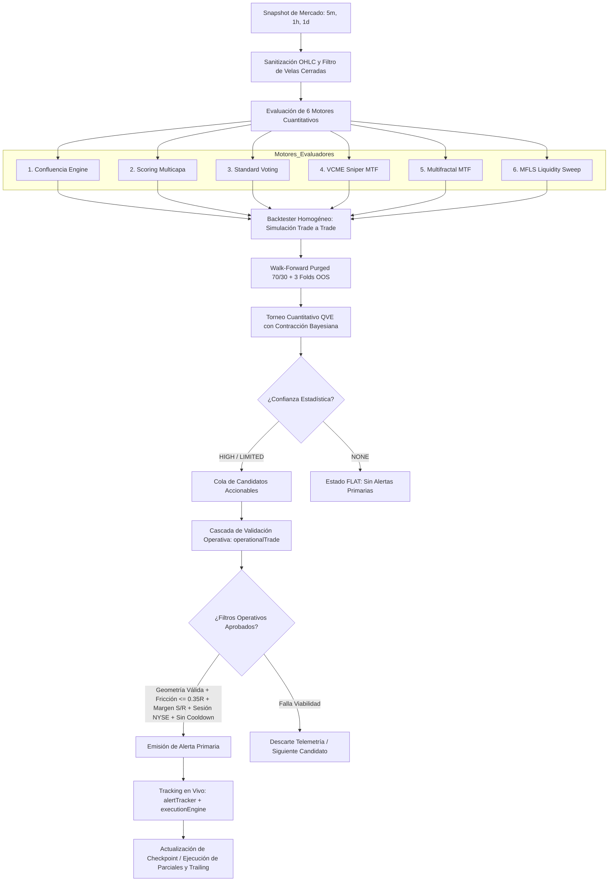

# FinceptTerminal (Terminal Lite) — Especificación Técnica y Documentación de Arquitectura, Motores de Señales y Sistema de Backtesting

> **Destinatario del documento:** Modelo de Inteligencia Artificial / Auditor Cuantitativo de Sistemas de Trading.  
> **Propósito:** Revisión exhaustiva, auditoría de código, verificación de supuestos matemáticos, paridad histórica/en vivo y robustez estadística.  
> **Versión de referencia:** React 19 + TypeScript 5.8 + Vite | Base de código `terminal-web`.

---

## 1. Resumen Ejecutivo y Filosofía del Sistema

**FinceptTerminal** es una estación de trabajo cuantitativa *client-only* (ejecutada íntegramente en el navegador web) diseñada para generar, filtrar, seleccionar y ejecutar alertas de trading intradía y swing en **acciones estadounidenses (Yahoo Finance)** y **criptomonedas (Binance)**.

### Principios Fundamentales de Diseño
1. **Zero-Backend Architecture:** La descarga de datos, cálculo de indicadores vectoriales, simulación de órdenes, selección de torneos cuantitativos y persistencia de auditoría operan 100% en el cliente (navegador). Las peticiones a Yahoo Finance y Zacks se enrutan a través de proxies transparentes (`/api/yahoo`, `/api/zacks`).
2. **Paridad Estricta Backtest/En Vivo (1:1 Parity):** Las mismas funciones puras de evaluación (`build*Context` y `evaluate*At`) y el mismo motor de ejecución cronológico (`runTradeSimulation`) alimentan tanto el backtest histórico como el monitor de alertas en vivo (`alertTracker.ts`). No existe código duplicado entre la simulación histórica y el seguimiento en tiempo real.
3. **Principio de Vela Cerrada (No Lookahead / Anti-Repaint):** Todas las decisiones cuantitativas se toman estrictamente sobre velas confirmadas cerradas (`getConfirmedClosedKlines`). Se calcula el tiempo de captura (`marketDataSnapshot.ts`) para certificar que la vela ha finalizado. La vela en formación en vivo solo se utiliza para calcular el PnL flotante y vigilar salidas estructurales de emergencia.
4. **Fricción Realista Institucional Obligatoria:** Ninguna estrategia se evalúa en bruto (Gross). Todo cálculo deduce:
   - **Comisión de corretaje:** `0.11%` (11 bps).
   - **Deslizamiento de mercado (Slippage):** `0.03%` (3 bps) en órdenes a mercado y stop.
   - **Fricción total de ida y vuelta:** `0.14%` (14 bps).
   - **Filtro de viabilidad económica:** Si la fricción total supera el `35%` del riesgo asumido ($Fricción_R > 0.35R$), la operación es descartada preventivamente (`isTradeFrictionViable`).
5. **Política Empírica de Acciones en 5m (5m Equities Policy):**
   - Calibrado sobre un universo de seguimiento de 21 acciones durante 60 días de datos tick/5m reales bajo fricción:
     - **Confluencia:** Única con resultado positivo en la calibración (+0,06R por alerta, ventana 09:35 a 10:55 ET), pero **no se sostuvo fuera de muestra** (v2026.10.15.1: −0,08R en 14 sesiones nuevas de la watchlist, −0,15R en 49 papeles no vistos). Desde entonces exige además ATR(14) ≥ 0,5% del precio (`CONFLUENCIA_EQUITY_5M_MIN_ATR_PCT`), lo que la deja cerca de 0R: sigue siendo la estrategia de alertas por ser la que menos pierde, no por tener ventaja comprobada.
     - **Estándar, Scoring, VCME, Multifractal y MFLS:** Presentan un arrastre neto negativo bajo fricción de 14 bps ($-0.13R$ a $-0.31R$). Por ende, en `5m` acciones se clasifican automáticamente como **Informativas** (`isInformationalStrategy`), quedando vetadas de ganar el torneo primario y solo emitiéndose como alertas exploratorias (`EXPLORATORY`) si el operador activa conscientemente el modo de investigación 🔬. En cripto y temporalidades mayores (`1h`, `1d`), todos los motores compiten plenamente.

---

## 2. Diagrama de Flujo del Pipeline Cuantitativo



---

## 3. Especificación Detallada de los 6 Motores de Señales

Cada motor implementa una arquitectura en dos fases:
- `build*Context(klines, interval, ...)`: Precomputa de forma vectorial todas las series de indicadores ($O(N)$).
- `evaluate*At(ctx, i, ...)`: Evalúa la vela $i$ en tiempo constante ($O(1)$), garantizando sincronía entre el backtester y el escáner en vivo.

```
+---------------------------------------------------------------------------------------------------+
| RESUMEN DE PARÁMETROS CLAVE DE LOS 6 MOTORES                                                     |
+----+-------------------+-------------------+--------------------+------------------+--------------+
| ID | Motor             | Horizonte 5m/1h   | Stop Loss (SL)     | Take Profit (TP) | Gestión      |
+----+-------------------+-------------------+--------------------+------------------+--------------+
| 1  | Confluencia       | 36 v. acc. / 24 v. cripto / 7 v. 1h | 2.0x ATR (piso 0.4%)| TP1: +1.5R | Salida única |
| 2  | Scoring Multicapa | 16 velas / 5 velas | 1.5x ATR (piso 0.4%)| TP1: +1.5R      | Salida única |
| 3  | Standard Voting   | 12 velas / 4 velas | 1.2x ATR (2.5x acc. 5m, piso 0.4%)| TP1: +1.5R | Salida única |
| 4  | VCME Sniper       | 24 velas / 48 vel | Chandelier / Swing | TP1:1.5R,TP2:3R  | Runner+Trail |
| 5  | Multifractal MTF  | 12 velas (5m, 1h) | Midpoint / 0.8-2x  | TP1: +1.5R       | Early Cutoff |
| 6  | MFLS Reversión    | 24 velas (2h)     | 0.8x ATR post-sweep| TP1:1.75R,TP2:3R | Two-Tier BE  |
+----+-------------------+-------------------+--------------------+------------------+--------------+
```

---

### Motor 1: Confluencia (Trend, VWAP & Geometry Engine)
- **Archivo fuente:** `src/utils/strategyEvaluators.ts` (líneas 56–196).
- **Enfoque conceptual:** Seguimiento de tendencia institucional de alta velocidad basado en alineación de medias móviles exponenciales rápidas, soporte de precio ponderado por volumen (VWAP) y confirmación de geometría de velas.

#### Indicadores Computados
- $EMA_9$, $EMA_{20}$ sobre cierres.
- $VWAP$ de sesión intradía con filtro de fiabilidad en velas iniciales (`vwapReliable`).
- $ATR(14)$ de Wilders.
- Media móvil de volumen: $SMA_{20}(Volume)$.
- $ADX(14)$ con $+DI$ y $-DI$.

#### Reglas de Activación de Entrada
**Lado Largo (BUY):**
1. **Alineación de Tendencia:** $EMA_9 > EMA_{20}$.
2. **Puerta Institucional VWAP:** $Close > VWAP$ (en las 2 primeras barras de la sesión se neutraliza para evitar monedas al aire por apertura degenerada).
3. **No Sobreextensión:** $\frac{|Close - VWAP|}{ATR} \le 2.2$.
4. **Volumen Válido:** $Volume > 0$ y $Volume \ge 0.8 \times SMA_{20}(Volume)$ (descarta activos sin volumen como Forex Yahoo o índices).
5. **Anatomía de Vela Válida:**
   - Cumple al menos uno:
     - Patrón Martillo (`isHammer`).
     - Patrón Envolvente Alcista (`isEngulfing === 1`) con $RatioCuerpo \ge 0.3$.
     - Vela Alcista Fuerte: $Close > Open$, $RatioCuerpo \ge 0.4$ y $Close > EMA_9$.
6. **Posición de Cierre (Close Position):** $CP = \frac{Close - Low}{High - Low} \ge 0.50$.
7. **Guardián Horario de Acciones en 5m:** Restringido obligatoriamente a velas que abren entre las **09:35 y 10:55 ET** (`isNyseOpeningHour`). La ventana de la tarde (14:00–15:15 ET) fue removida empíricamente tras demostrar $-0.23R$ de arrastre neto negativo.

**Lado Corto (SELL):**
- Reglas simétricas: $EMA_9 < EMA_{20}$, $Close < VWAP$, $\frac{|Close - VWAP|}{ATR} \le 2.2$, $Volume \ge 0.8 \times SMA_{20}$, Estrella Fugaz / Envolvente Bajista / Bajista Fuerte, y $CP \le 0.50$.

#### Geometría de Salida y Gestión de Riesgo
- **Stop Loss:**
  $$\text{Distancia bruta} = \frac{2.0 \times ATR}{Close}$$
  $$\text{StopPct} = \max(0.0040, \text{Distancia bruta}) \quad \text{(Piso del 0.40\% en 5m)}$$
  $$SL_{Long} = Close \times (1 - \text{StopPct}), \quad SL_{Short} = Close \times (1 + \text{StopPct})$$
- **Take Profit:** Objetivo único a $+1.5R$ ($Close \pm 1.5 \times \text{Riesgo}$).
- **Horizonte Temporal (Timeout):** 36 velas en acciones 5m (3 h), 24 velas en cripto 5m (2 h), 7 velas en 1h, 6 velas en 1d.
- **Filtro de volatilidad (acciones 5m, desde v2026.10.15.1):** sin señal si $ATR_{14} / Close < 0.5\%$ (`CONFLUENCIA_EQUITY_5M_MIN_ATR_PCT`). Con ese mínimo, $2 \times ATR \ge 1\%$ y el piso de 0,40% nunca actúa en acciones 5m.

---

### Motor 2: Scoring Multicapa (Multi-Layer Weighted Consensus)
- **Archivo fuente:** `src/utils/strategyEvaluators.ts` (líneas 198–761).
- **Enfoque conceptual:** Modelo cuantitativo ponderado de 6 capas analíticas independientes que evalúan desde la tendencia macro hasta la microestructura de soporte y resistencia.

#### Las 6 Capas Analíticas y sus Fórmulas
1. **Capa 1 — Tendencia ($w_{trend} = 1.0$):**
   - Alineación rápida: $+1.0$ si $EMA_{fast} > EMA_{slow}$, $-1.0$ si menor.
   - Tendencia mayor: Mapeo continuo suave mediante tangente hiperbólica:
     $$S_{major} = \tanh\left(\frac{Close - EMA_{major}}{ATR}\right)$$
2. **Capa 2 — Momento RSI ($w_{rsi} = 1.0$):**
   - Período 14, evalúa la pendiente de 3 velas ($\Delta RSI$).
   - Matriz de zonas simétrica alrededor de 50:
     - $RSI > 80$ subiendo: $0.0$ (neutraliza sobrecompra extrema / agotamiento).
     - $RSI \in [50, 72]$ subiendo: $+1.0$ (momentum fuerte).
     - $RSI \in [40, 50)$ subiendo: $+1.0$ (recuperación de pullback en soporte).
     - $RSI < 20$ bajando: $0.0$ (neutraliza capitulación extrema para evitar vender suelos).
     - $RSI \in (28, 50]$ bajando: $-1.0$ (presión bajista activa).
3. **Capa 3 — Volatilidad y Bollinger ($w_{bollinger} = 1.0$):**
   - Evalúa $\%B = \frac{Close - Lower}{Upper - Lower}$.
   - Detección de *Squeeze* Adaptativo: Bandwidth actual $< 70\%$ del promedio móvil de 30 velas.
   - Si hay Squeeze con ruptura alcista sobre la media: $+1.0$.
   - En régimen normal: $\%B \in [0.70, 0.95]$ con mecha superior $< 25\% \to +1.0$ (*walking the band*). Rechazo con mecha superior $> 25\% \to -0.5$.
4. **Capa 4 — Volumen y Flujo Institucional ($w_{vol} = 1.0$):**
   - En intradía (`useVwap = true`): Mapeo continuo no lineal asintótico:
     $$S_{vol} = \tanh\left(\frac{Close - VWAP}{ATR}\right)$$
   - En 1D (`useObv = true`): Mapeo continuo del diferencial OBV vs su media:
     $$S_{vol} = \tanh\left(\frac{OBV - EMA_{10}(OBV)}{VolAvg_{20}}\right)$$
5. **Capa 5 — Anatomía de Vela ($w_{candle} = 1.0$):**
   - Evalúa $\%Cuerpo = \frac{|Close - Open|}{High - Low}$. Si es $< 30\% \to 0$ (Doji).
   - Cuerpo alcista $\ge 50\% \to +1.0$. Si tiene mecha superior $> 25\%$, penaliza $-0.5$ por rechazo.
6. **Capa 6 — Estructura Soporte/Resistencia ($w_{struct} = 1.0$):**
   - Pivots fractales rodantes de 100 velas (resuelto cada 5 barras en caché).
   - Proximidad $< 1.5\%$ de un soporte validado $\to +1.0$. Proximidad $< 1.5\%$ de resistencia $\to -1.0$.

#### Ponderación, Umbral y Filtros de No-Contradicción
- **Score Total:** $\sum_{k=1}^6 w_k S_k$.
- **Umbral de Disparo:** $Threshold = MaxPossibleScore \times 0.45$ (típicamente $3.15$ en 5m y $3.83$ en 1h).
- **Regla de No-Contradicción Inter-Capas (Non-Dissent Rule):**
  - Si la señal es `BUY`, pero la Capa 3 marca rechazo severo en Bollinger ($S_3 \le -0.5$) o la Capa 4 muestra volumen distribuidor ($S_4 \le -0.5$), la señal es **vetada a HOLD**.
- **Veto Direccional Incondicional de VWAP:** Jamás se permite `BUY` bajo VWAP ni `SELL` sobre VWAP.
- **Filtro de Espacio Estructural R:R:** Valida que la distancia hacia la resistencia más cercana sea estrictamente mayor que la distancia al TP1.
- **Filtros de Acciones en 5m:** Ventas en corto (`SELL`) desactivadas; pausas durante apertura (09:30–09:35), almuerzo (11:30–14:00) y cierre (>15:15 ET).

---

### Motor 3: Standard Voting (Democratic Indicator Consensus)
- **Archivo fuente:** `src/utils/strategyEvaluators.ts` (líneas 762–974).
- **Enfoque conceptual:** Consenso democrático robusto entre 7 indicadores clásicos de análisis técnico con filtro macro de tendencia.

#### Votantes y Criterios Individuales
1. **RSI(14):** Compra si $RSI < 30$ con pendiente $\ge 0$ o rebote de pullback en soporte alcista ($Close > EMA_{200}$ y $RSI \in [35, 48]$). Venta simétrica.
2. **MACD(12, 26, 9):** Cruce de línea de señal y orientación del histograma.
3. **Bollinger Bands(20, 2):** Cierre fuera de bandas condicionado al volumen. Si hay expansión con volumen saludable, permite caminar la banda.
4. **Supertrend(10, 3.0):** Voto activado si ocurrió una inversión de dirección (*flip*) en las últimas 3 velas.
5. **Stochastic RSI(14, 14, 3, 3):** Cruces de $\%K$ sobre $\%D$ saliendo de sobreventa/sobrecompra.
6. **Volumen Relativo:** Ratio respecto a la media móvil de 20 períodos.
7. **Filtro de Tendencia Macro $EMA_{200}$:** Veta compras bajo la media de 200 y ventas sobre ella, salvo consenso extremo ($\ge 3$ votos de margen y cero votos opuestos).

#### Reglas de Decisión
- **Umbral de Consenso:** Requiere un margen mínimo:
  $$\text{Margen} = |Votos_{Buy} - Votos_{Sell}| \ge 2$$
  *(Un margen de 1 voto es catalogado como ruido y forzado a NEUTRAL).*
- **STRONG BUY / SELL:** Margen $\ge 3$ con $0$ votos en contra.
- **Filtro RVOL:** $RVOL \ge 0.90$.
- **Anatomía de Vela:** $CP \ge 0.45$ para compras, $CP \le 0.55$ para ventas.
- **Parámetros de Salida:** SL a $1.2 \times ATR$ (o $2.5 \times ATR$ en acciones 5m), TP a $+1.5R$. Timeout en 12 velas (5m) o 4 velas (1h).

---

### Motor 4: VCME Sniper Engine (Volume & Candle Momentum Engine)
- **Archivo fuente:** `src/utils/strategyEvaluators.ts` (líneas 976–1816).
- **Enfoque conceptual:** Sistema multitemporal jerárquico institucional 1D-1H-5M diseñado para cazar impulsos con expansión de volatilidad y gestión dinámica de runners.

#### Estructura Jerárquica Multitemporal
1. **Nivel 1 — Sesgo Macro 1D (Bias 1D):**
   - Determinado por $Close_{1D}$ vs $EMA_{200}(1D)$, cruce de $EMA_{50}$ sobre $EMA_{200}$, $ADX(1D) > 20$, y $+DI > -DI$.
   - Genera sesgo: `ALCISTA`, `BAJISTA` o `NEUTRAL`.
2. **Nivel 2 — Setup Estructural 1H (Ventana de Memoria de 3 Horas):**
   - Requiere $EMA_{20}(1H) > EMA_{50}(1H)$, pendiente de $EMA_{200}(1H) \ge 0$, $ADX(1H) \ge 18$, $RSI(1H) \in [45, 80]$, e histograma MACD creciente.
   - El setup queda "armado" durante un máximo de 3 barras de 1 hora mientras no se pierda el VWAP ni el cruce de medias.
3. **Nivel 3 — Gatillo de Ejecución en 5M:**
   - **Modo Agresivo (Pullback Continuation):** Retroceso a la zona de $EMA_9$, $EMA_{21}$ o $VWAP$ en 5m, seguido de una vela de intención que rompe el máximo de las 3 velas previas con $RVOL \ge 1.5$ (en compras) o $RVOL \ge 1.8$ (en ventas) y $Close > VWAP$.
   - **Modo Conservador (Breakout & Retest):** Ruptura previa de bandas de Bollinger bajo Squeeze previo (Pivote percentil 20 de ancho de banda) con retest exitoso sostenido sobre el nivel roto.
   - **ORB (Opening Range Breakout):** Ruptura del rango de los primeros 30 minutos de sesión respaldada por compresión previa.

#### Salidas Estructurales y Gestión de Runners (3-Tier Partials)
- **Escalado en 3 Tramos:**
  - **TP1 (50% de la posición):** $+1.5R$ $\to$ El Stop Loss del resto se desplaza a **Breakeven (Precio de entrada)**.
  - **TP2 (25% de la posición):** $+3.0R$ $\to$ El Stop Loss restante se asegura en TP1.
  - **TP3 / Runner (25% restante):** Gestionado mediante **Trailing Chandelier Stop**:
    $$TrailingSL_{Long} = HighestHigh - 2.5 \times ATR$$
    Salida adicional si una vela de 5m cierra por debajo de la $EMA_9$.
- **Time Stop:** Si tras 18 barras (90 min) la posición no ha alcanzado al menos $+0.5R$, se liquida a mercado.
- **Early Adverse Cutoff:** Si en las primeras 3 barras la pérdida flotante supera $0.5R$, se cierra inmediatamente para minimizar el arrastre.
- **Salida de Emergencia:** Si el precio cruza simultáneamente por debajo de VWAP y $EMA_{21}$, se ejecuta cierre de emergencia.

---

### Motor 5: Multifractal MTF (Revolution Volatility & DreadBlitz)
- **Archivo fuente:** `src/utils/strategyEvaluators.ts` (líneas 1817–2093).
- **Enfoque conceptual:** Análisis de fractales de volatilidad y composición de volumen activo/pasivo para operar rupturas explosivas o reversiones por absorción.

#### Componentes Cuantitativos
1. **1D — Oscilador Andian:** Determina el régimen macro mediante bandas de energía verde, roja y naranja.
2. **1H — Bandas de Volatilidad Revolution (Squeeze):** Evalúa si el marco horario se encuentra en compresión de volatilidad antes de la expansión.
3. **5M — DreadBlitz Momentum & Composición de Volumen:**
   - Calcula el porcentaje de volumen comprador vs vendedor activo.
   - Detecta absorción institucional pasiva (mechas extensas con volumen alto que no desplazan precio).
   - Oscilador DreadBlitz: Métrica MCD con umbrales de sobrecompra y sobreventa.

#### Estrategias Ejecutadas
- **Estrategia A: Ruptura de Rango con Expansión (Breakout):**
  - Sesgo 1D alineado + Squeeze activo en 1H + Cierre en 5m fuera de la banda Revolution + Volumen activo $\ge 58\%$ + Multiplicador de volumen $\ge 1.5x$ ($1.8x$ en apertura NYSE).
  - Stop Loss colocado en el **punto medio del canal de volatilidad de 5m**.
- **Estrategia B: Reversión a la Media por Absorción (Mean Reversion):**
  - Prohibido operar contra el sesgo 1D confirmado (no compras en sesgo bajista ni ventas en sesgo alcista).
  - Divergencia en DreadBlitz MCD + Absorción pasiva confirmada en volumen.
  - Stop Loss colocado tras el extremo de absorción: $Low - 0.25 \times AnchoBanda$.
- **Límites de Riesgo:** Stop acotado estrictamente entre $0.8 \times ATR$ y $2.0 \times ATR$ (máximo riesgo del $2.5\%$). Salida temporal en 12 velas (1 hora).

---

### Motor 6: MFLS (MACD Failure & Liquidity Sweep)
- **Archivo fuente:** `src/utils/strategyEvaluators.ts` (líneas 2094–2496).
- **Enfoque conceptual:** Detección de trampas institucionales, barridos de liquidez (*liquidity sweeps*) sobre pivotes fractales de swing y fallo de momento en el histograma MACD.

```
MFLS Setup Visual:
Resistencia/Soporte Fractal ------------x-----------------------------
                                       / \  <- Barrido (Sweep <= 1.8x ATR)
                                      /   \
      Precio vuelve a entrar --------+-----+-- Cierre de confirmación (Reclaim)
                                            \
                                             \-> Fallo de MACD (Higher Low en MACD)
                                                 + Mecha de rechazo >= 25%
```

#### Reglas de Detección de la Trampa y Gatillo
1. **Barrido de Liquidez (Sweep):**
   - El precio perfora un Swing Low previo (en compras) o Swing High previo (en ventas) identificado mediante fractales de 20 velas.
   - La profundidad de la penetración debe ser controlada: $\text{SweepDepth} \le 1.8 \times ATR$ (si penetra más, se considera ruptura genuina y se descarta).
2. **Recuperación al Cierre (Reclaim):**
   - La vela de señal debe cerrar de vuelta dentro del nivel: $Close > SwingLow_{prev}$ en compras; $Close < SwingHigh_{prev}$ en ventas.
3. **Desbalance Previo (Imbalance / Displacement):**
   - Las 4 velas previas deben evidenciar un desplazamiento rápido (al menos 2 velas de cuerpo amplio $\ge 45\%$ o una caída/subida acumulada $\ge 1.6 \times ATR$).
4. **Fallo de Momento en MACD (MACD Failure):**
   - En compras: La línea de MACD debe estar curvándose hacia arriba ($MACD_i > MACD_{i-1}$) y marcando un mínimo más alto que en la vela del pivote original ($MACD_i > MACD_{pivot}$), confirmando el agotamiento de la presión vendedora.
5. **Confirmación por Mecha de Rechazo:**
   - La mecha de absorción en la dirección del rechazo debe representar al menos el $25\%$ del rango de la vela (y al menos el $40\%$ si el $RVOL \ge 6.0$).
   - Filtro de noticias anómalas: Si $RVOL \ge 8.0x$, se descarta por riesgo de noticias descontroladas.
6. **Ventana de Sesión en Acciones:** Limitado a **09:45 a 15:30 EST** (`isMFLSSessionWindow`).

#### Salidas Estructurales y Gestión Two-Tier
- **Stop Loss:** Colocado a $0.8 \times ATR$ más allá del extremo del barrido ($SweepPrice$), con piso estructural del $0.40\%$.
- **Objetivos (Two-Tier):**
  - **TP1 (50% de la posición):** $+1.75R$ $\to$ SL a Breakeven.
  - **TP2 (50% restante):** $+3.0R$.
- **Gestión Temporal:** Time Stop en 16 velas (80 min) si el beneficio no alcanza $+0.4R$. Early Adverse Cutoff en 3 velas ($> 0.5R$ de pérdida).

---

## 4. El Sistema de Backtesting Cuantitativo y Reductor Cronológico

### Reductor de Simulación Trade-a-Trade (`executionEngine.ts`)
A diferencia de los simuladores simplistas basados en matrices vectoriales que sobreestiman los resultados por sesgo de anticipación, `FinceptTerminal` procesa cada trade a través de un **reductor cronológico de barras**:

1. **Prioridad Estricta en Ambivalencia Intra-Barra (Stop-First Assumption):**
   - Si en una misma barra el máximo alcanza el Take Profit y el mínimo perfora el Stop Loss, el motor asume de forma conservadora que **el Stop Loss se ejecutó primero**, registrando la pérdida completa.
2. **Ejecución por Gaps (Gap-Through Stops):**
   - Si la vela abre con un gap por debajo del Stop Loss ($Open < SL$), el trade se ejecuta al precio de apertura ($Open$), computando el deslizamiento adverso real y evitando salidas a precios ideales no existentes.
3. **Corte por Gaps de Sesión (Session Gap Cutoff):**
   - En acciones intradía, las órdenes que queden abiertas al sonar la campana de cierre (16:00 ET) se liquidan forzosamente (`SESSION_GAP` / `EXPIRED`). Se prohíbe mantener posiciones durante la noche (*overnight*) salvo para el modelo específico VCME Swing en 1h.
4. **Persistencia mediante Checkpoints Resumibles (`TradeExecutionState`):**
   - El estado de cada trade se guarda con su histórico de ejecuciones parciales (`fills`), cursor de la última vela cerrada y niveles activos. Cuando llega una nueva vela en vivo, la simulación continúa desde el cursor sin reevaluar barras pasadas.

### Validación Walk-Forward Purgada (Purged Expanding Walk-Forward)
- **Partición:** $70\%$ In-Sample (IS) para estimación y $30\%$ Out-of-Sample (OOS) para validación.
- **Purgado de Frontera (Purged Partitioning):** Aquellas operaciones abiertas durante el periodo In-Sample pero cuyo cierre ocurre dentro del Out-of-Sample son **completamente purgadas** de ambos conjuntos, eliminando el sesgo de derrame de información (*information leakage*).
- **Validación Multi-Fold:** Se ejecutan 3 folds anclados y expandibles para verificar la estabilidad de la ventaja a lo largo de distintos ciclos de volatilidad.
- **Modulación Bayesiana Continua OOS:**
  En lugar de un corte binario frágil (ej. descartar un motor que rindió $+0.08R$ por no llegar a $+0.10R$), el multiplicador OOS modula suavemente el puntaje del torneo:
  $$\text{Multiplicador OOS} \in [0.35, 1.15]$$
  - OOS Aprobado ($E[R] \ge 0.10R$ y $N \ge 3$): Factor $1.15x$.
  - Muestra Reducida Inconclusa: Factor $0.70x - 0.90x$.
  - OOS Tóxico ($E[R] < -0.15R$ o $PF < 0.70$): Penalización severa a $0.35x$.

---

## 5. El Torneo Cuantitativo de Selección (QVE Tournament)

Para cada activo y horizonte temporal, `runQVESelection` somete a los 6 motores a un torneo estadístico riguroso (`tournament.ts`):

> **Alcance de la confianza (v2026.10.15.2):** HIGH / LIMITED resumen el backtest reciente del papel, no una ventaja validada. En acciones 1h, `scripts/engines-1h-validation.ts` (106 papeles, nov-2023 → oct-2026, 0,11% en el día / 0,22% si se cruza la noche) dio E[R] neto negativo para Confluencia, Scoring, Estándar y VCME swing en todos los cortes, con ventaja bruta ≈ 0 o negativa. Por eso la interfaz las muestra como "Backtest favorable" y "Backtest con muestra limitada". Cripto no fue validado fuera de muestra.

```mermaid
flowchart LR
    A[Métricas In-Sample] --> B[Contracción Bayesiana: E_R_shrunk]
    B --> C[Normalización Temporal: Horas de Exposición]
    C --> D[Penalización por Drawdown > 2.5R]
    D --> E[Ajuste Asimétrico Sortino]
    E --> F[Modulación por Régimen de Mercado: ADX Histéresis]
    F --> G[Deflación por Multiplicidad de Modelos: Bonferroni]
    G --> H[Multiplicador Bayesiano Walk-Forward OOS]
    H --> I[Puntaje Compuesto Final]
```



### Formulación Matemática del Puntaje del Torneo

1. **Contracción Bayesiana Empírica (Shrinkage hacia $H_0: E[R] = 0$):**
   Evita que rachas fortuitas de 2 operaciones ganadoras coronen a un motor:
   $$\text{Shrinkage} = \frac{N}{N + N_0}, \quad E[R]_{shrunk} = E[R]_{IS} \times \text{Shrinkage}$$
   *(donde $N_0 = 4$ para snipers y $N_0 = 6$ para scalpers en 5m).*
2. **Normalización Temporal Sub-difusiva:**
   Normaliza el rendimiento en función del tiempo de exposición del capital:
   $$\text{FactorTiempo} = \left(\max\left(1.0, \frac{\text{HorasExposición}}{\text{HorasBase}}\right)\right)^{0.35}$$
3. **Penalización por Drawdown Severo:**
   $$DD_{penalty} = \exp\left(-\frac{\max(0, MDD_R - 2.5)}{3.0}\right)$$
4. **Ajuste por Ratio Sortino:**
   Premia la asimetría positiva en la volatilidad bajista:
   $$\text{SortinoMult} = 1.0 + \min(0.20, \text{Sortino} \times 0.05)$$
5. **Histéresis de Régimen de Mercado (ADX 26/22):**
   Para evitar oscilaciones caóticas de estado:
   - Entra en modo **Tendencia** cuando $ADX \ge 26.0$.
   - Permanece en tendencia hasta que $ADX \le 22.0$ (donde conmuta a **Rango**).
   - El puntaje modula según la rentabilidad histórica del motor en dicho régimen.
6. **Deflación por Multiplicidad de Modelos (White's Reality Check / Bonferroni):**
   Penaliza el sesgo de selección del máximo entre $K$ modelos candidatos:
   $$\text{MultiplicityFactor} = \frac{1}{\sqrt{1 + 0.10 \times \max(0, K_{activos} - 1)}}$$

### Niveles de Confianza Estadística
- **HIGH (Alta Confianza):** Muestra representativa ($N \ge 8$ en scalping, $N \ge 6$ en snipers), $PF \ge 1.25$, Walk-Forward `PASS` ($E[R]_{OOS} \ge 0.10R$) y régimen favorable.
- **LIMITED (Confianza Limitada):** Muestra mínima ($N \ge 3$), $PF \ge 1.0$, sin evidencia OOS tóxica. Emite alertas primarias con etiquetado prudente.
- **NONE (Sin Ventaja / Flat):** Sin ventaja estadística demostrada o muestra insuficiente ($N < 3$). El sistema permanece **FLAT** y bloquea la emisión de alertas primarias.

---

## 6. Cascada de Candidatos y Emisión Operativa de Alertas

Cuando el ganador del torneo se encuentra en señal `NEUTRAL` en la vela cerrada actual, el sistema ejecuta una **cascada jerárquica de candidatos** (`operationalTrade.ts` y `alertEmission.ts`):

1. **Orden de Prioridad en la Cascada:**
   - 1º: Ganador del torneo primario (si emite señal y pasa el filtro direccional OOS).
   - 2º: Estrategias secundarias con ventaja In-Sample positiva y sin toxicidad OOS, ordenadas por su puntaje bayesiano descendente.
   - 3º: Si el usuario habilitó 🔬 (`allowExploratoryAlerts`), candidatos exploratorios con confianza `NONE`.
2. **Compuertas de Viabilidad Operativa:**
   - **Geometría Válida:** $Entry > SL$ y $TP > Entry$ en compras; inverso en ventas.
   - **Límite de Fricción Económica:**
     $$\text{Fricción}_R = \frac{0.14\%}{|Entry - SL| / Entry} \le 0.35R$$
     *(Descarta micro-stops donde las comisiones devoran más del 35% del riesgo).*
   - **Espacio Estructural (S/R Room):** Verificación de que el primer soporte o resistencia relevante no obstruya el camino hacia TP1.
   - **Una Posición por Activo y Marco:** Si ya existe una posición abierta (`OPEN`, `TP1_HIT`, `TP2_HIT`), no se emiten nuevas alertas para ese símbolo e intervalo.
   - **Guardián de Vela de Cierre de Sesión:** Rechazo de cualquier entrada en la última vela de la sesión regular de Wall Street (15:55 ET) para evitar saltos nocturnos impredecibles (*overnight gaps*).
   - **Enfriamiento Anti-Venganza (Post-Exit Cooldown):** Asimétrico (`getStrategyCooldownMs`): en 5m intradía, 30 min tras la emisión o un stop (anti-venganza) y 5 min (1 vela) tras objetivo o timeout; 4 h en 5m swing, 4 velas en 1h y 2 velas en 1d.

---

## 7. Métricas de Rendimiento y Contabilidad en Unidades R

El sistema estandariza toda su contabilidad en **Múltiplos de Riesgo (R)** para garantizar independencia del precio nominal del activo:
- **Riesgo Inicial:** $1.0R = |Entry - StopLoss_{inicial}|$.
- **PnL Neto en R:**
  $$\text{Realized } R = \frac{\text{Retorno Neto \%}}{\text{Riesgo Inicial \%}} = \frac{\text{Retorno Bruto \%} - \text{Fricción \%}}{\text{Riesgo Inicial \%}}$$
- **Banda de Scratch:** Todo trade con $|\text{Realized } R| \le 0.05R$ es catalogado económicamente como neutro/empate (*scratch* o *timeout*), no como ganancia o pérdida.
- **Profit Factor Canónico en R:**
  $$PF = \frac{\sum R_{ganados}}{\sum |R_{perdidos}|}$$
  *(Si no hay pérdidas, se registra formalmente como `null` / "PF N/D" para evitar singularidades infinitas).*

---

## 8. Guía de Auditoría para la IA Revisora

Al auditar esta arquitectura y sus algoritmos, se sugiere a la IA revisora focalizar su análisis en los siguientes puntos críticos:

1. **Paridad de Fórmulas:** Comprobar que los multiplicadores ATR en `src/utils/tradeLevels.ts` coincidan exactamente con los usados en `src/utils/strategyEvaluators.ts` y `src/utils/backtester.ts`.
2. **Tratamiento del VWAP en Inicios de Sesión:** Verificar cómo la neutralización en las primeras 2 barras de sesión previene falsos positivos en el cálculo de Confluencia y Scoring.
3. **Ausencia de Sesgo de Mirada Hacia Adelante (Lookahead Bias):** Comprobar que `getConfirmedClosedKlines` y `runTradeSimulation` nunca lean el índice $i+1$ durante la toma de decisiones en la barra $i$.
4. **Conservadurismo en Ambivalencia Intra-Barra:** Auditar la línea 178 de `executionEngine.ts` para constatar que los stops se evalúan antes que los targets cuando ambos precios caen dentro del rango $[Low, High]$.
5. **Manejo de Gaps Nocturnos:** Revisar la función de corte `isFirstCandleAcrossSessionGap` en `alertTracker.ts` para asegurar que las alertas que cruzan el fin de semana o la noche sin ejecución se cierren en `EXPIRED` con $0.0R$ sin registrar stops espurios de $-10R$.
6. **Robustez de la Modulación Bayesiana:** Verificar si el castigo OOS ($0.35x$) y la contracción In-Sample ($N / (N + N_0)$) protegen adecuadamente contra el sobreajuste (*overfitting*) en muestras pequeñas ($N < 10$).
